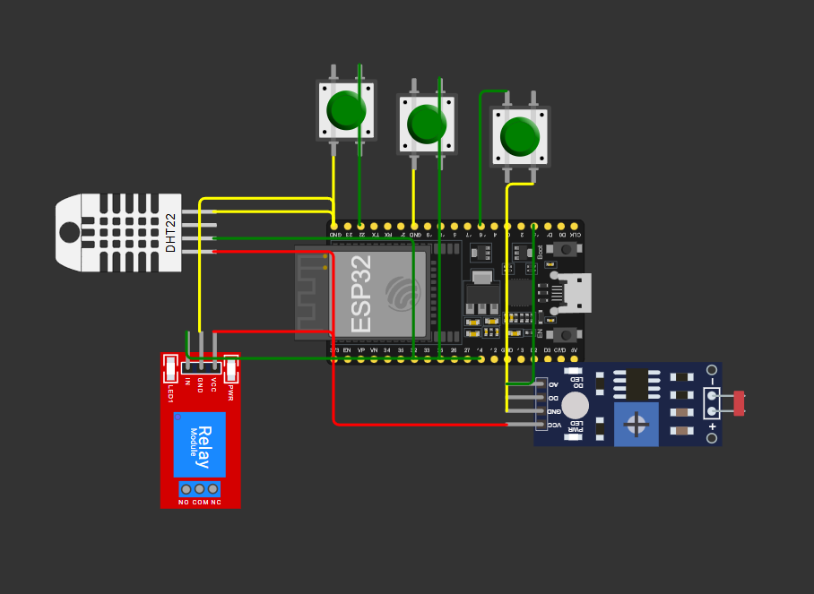
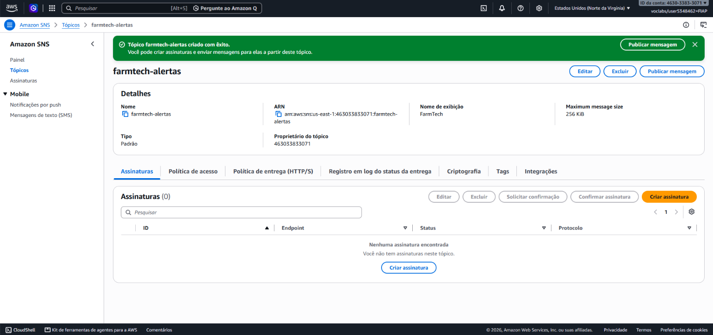
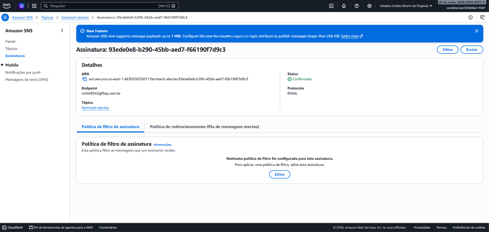
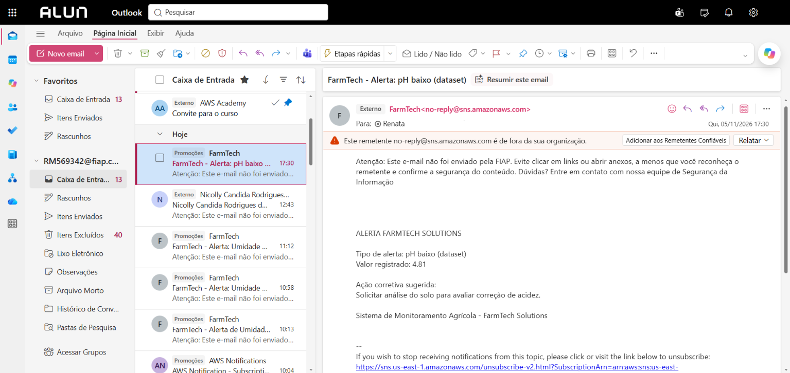

# FIAP - Faculdade de Informática e Administração Paulista

<p align="center">
<a href= "https://www.fiap.com.br/"></a>
</p>

<br>

# FarmTech Solutions — Fase 7: A Consolidação de um Sistema

## FarmTech Solutions

## 👨‍🎓 Integrantes:
- David Ribeiro Prado de Lacerda — RM570350
- Giselli Mayumi Takahashi Yokoyama — RM572690
- João Otavio Moraes — RM573227
- Pedro Henrique Lacerda — RM573114
- Renata de Almeida Marinho — RM569342

## 👩‍🏫 Professores:
### Tutor(a)
- [Nicolly Candida Rodrigues de Souza](https://github.com/nicollycrs)
### Coordenador(a)
- [André Godoi Chiovato](https://www.linkedin.com/in/andregodoichiovato/)


## 📜 Descrição

A FarmTech Solutions é uma startup acadêmica que aplica IA, IoT e Ciência de Dados ao agronegócio. Ao longo das Fases 1 a 6, o grupo construiu os serviços separadamente. Na Fase 7 eles são reunidos em um único sistema de gestão da fazenda.

O sistema reúne:

1. **Gestão da lavoura (Fase 1):** cálculo de área e de insumos em Python, com análise estatística e meteorológica em R.
2. **Irrigação inteligente com IoT (Fase 2):** ESP32 com sensores de umidade, pH e NPK, previsão de chuva via OpenWeather e controle da bomba.
3. **Banco de dados estruturado (Fase 3):** leituras dos sensores armazenadas e consultadas no Oracle.
4. **Dashboard com Data Science (Fase 4):** Streamlit e Scikit-Learn com previsões de rendimento, irrigação e fertilização e recomendações de manejo.
5. **Nuvem (Fase 5):** estimativa de custo e escolha de região na AWS, além de modelos de previsão de rendimento de safras.
6. **Visão computacional (Fase 6):** YOLOv5s treinada com o dataset AgroInsect para detectar 4 pragas de soja e milho, com inferência local e acionamento pela dashboard.
7. **Alertas na AWS (Fase 7):** Amazon SNS envia por e-mail aos funcionários os alertas dos sensores e da visão computacional, com a ação corretiva de cada caso.

> 🚧 **Status: em desenvolvimento.** Os serviços estão integrados à dashboard. O que falta para a entrega está em [Pendências da Fase 7](#-pendências-da-fase-7).


## 📁 Estrutura de pastas

Dentre os arquivos e pastas presentes na raiz do projeto, definem-se:

- <b>assets</b>: elementos não-estruturados do repositório, como imagens: logo da FIAP, circuito do Wokwi e tabela Oracle (`fase2/`), prints do SQL Developer (`fase3/`), prints da AWS Pricing Calculator (`fase5/`) e prints do console da AWS com os alertas (`aws/`).

- <b>document</b>: documentos do projeto. Na subpasta `other`, o `MAPEAMENTO.md` registra a origem de cada arquivo nos repositórios das fases anteriores.

- <b>src</b>: todo o código-fonte das fases, organizado por serviço:
  - `fase1_gestao_lavoura/`: CRUD de manejo (Python) e estatística/meteorologia (R).
  - `fase2_irrigacao_iot/`: firmware do ESP32 (Wokwi) e previsão de chuva pela OpenWeather.
  - `fase2_colheita_cana/`: perdas na colheita de cana (Python, JSON e Oracle).
  - `fase3_banco_oracle/`: dados dos sensores, DDL, consultas SQL e serviço em Python.
  - `fase3_ml_recomendacao_culturas/`: notebook com 5 classificadores para recomendar culturas.
  - `fase5_ml_rendimento_safras/`: notebook com EDA, clusterização e 5 regressores de rendimento.
  - `fase6_visao_computacional/`: serviço YOLO de detecção de pragas (preparação do dataset, treino e inferência), com o modelo treinado em `modelos/` e 4 imagens de teste em `amostras/`.
  - `aws/`: alertas por e-mail no Amazon SNS, a partir dos sensores e da visão computacional.
  - `dashboard/`: dashboard final, evoluída da Fase 4, que dispara os serviços pela aba **Serviços**.

- <b>.env.example</b>: modelo das variáveis de ambiente (OpenWeather, Oracle e tópico SNS).

- <b>requirements.txt</b>: dependências Python de todo o sistema.

- <b>README.md</b>: arquivo que serve como guia e explicação geral sobre o projeto (o mesmo que você está lendo agora).


## 🔧 Como executar o código

### Pré-requisitos
- Python 3.10+
- R 4.x (Fase 1)
- Conta no [Wokwi](https://wokwi.com) (Fase 2)
- Acesso ao Oracle FIAP (Fases 2 e 3)
- Chave gratuita da [OpenWeather API](https://openweathermap.org/api) (Fase 2)
- AWS Academy Learner Lab ativo, com o tópico SNS criado (alertas da Fase 7)
- GPU NVIDIA, somente para treinar o YOLO. A detecção funciona sem GPU e sem treinar, com o modelo já incluído.

### Instalação
```bash
git clone https://github.com/dokitodavid/farmtech-solutions.git
cd farmtech-solutions
python -m venv .venv
.venv\Scripts\activate          # Windows  (Linux/Mac: source .venv/bin/activate)
pip install -r requirements.txt
copy .env.example .env          # Windows  (Linux/Mac: cp .env.example .env), depois preencha
```

### Serviços

| Serviço | Comando (a partir da raiz) |
|---|---|
| Dashboard (Fase 4) | `streamlit run src/dashboard/streamlit_app.py` |
| Pipeline de ML no terminal (Fase 4) | `python src/dashboard/farmtech_ml.py` |
| Gestão de manejo (Fase 1) | `cd src/fase1_gestao_lavoura && python gestao_manejo.py` |
| Estatística + meteorologia (Fase 1) | `cd src/fase1_gestao_lavoura && Rscript analise_estatistica.R` |
| Previsão de chuva (Fase 2) | `python src/fase2_irrigacao_iot/openweather_chuva.py` |
| Irrigação ESP32 (Fase 2) | Wokwi: importar `esp32/diagram.json` e `esp32/farmtech_fase2.ino` (link em `esp32/wokwi-project.txt`) |
| Colheita de cana (Fase 2) | `cd src/fase2_colheita_cana && python main.py` |
| Notebooks de ML (Fases 3 e 5) | `jupyter notebook`, abrindo `src/fase3_ml_recomendacao_culturas/` ou `src/fase5_ml_rendimento_safras/` |
| Banco Oracle (Fase 3) | `python src/fase3_banco_oracle/servico_oracle.py` ou `consultas.sql` no SQL Developer |
| Preparar o dataset (Fase 6) | Baixar o AgroInsect conforme o [README da Fase 6](src/fase6_visao_computacional/README.md#baixar-e-extrair) e rodar `python src/fase6_visao_computacional/preparar_dataset.py` |
| Treinar o modelo YOLO (Fase 6) | `python src/fase6_visao_computacional/treinar.py` |
| Detectar pragas (Fase 6) | `python src/fase6_visao_computacional/inferir.py --fonte src/fase6_visao_computacional/amostras` ou aba **Detecção de Pragas** da dashboard |
| Alertas dos sensores (Fase 7) | `python -m src.aws.alertas_sensores` simula; com `--enviar`, publica no SNS |
| Alertas de pragas (Fase 7) | `python -m src.aws.alertas_pragas` simula; com `--enviar`, publica no SNS |

> Os serviços acima também podem ser disparados pela aba **Serviços** da dashboard, exceto a preparação do dataset e o treino do YOLO, que rodam só no terminal.

> Os serviços da Fase 1 e da colheita leem e gravam arquivos na pasta corrente. Por isso o `cd` antes de executá-los.


## 🧩 Serviços das fases anteriores

### Fase 1 — Gestão da lavoura (Python + R)
- **`gestao_manejo.py`:** CRUD de lavouras de café e soja, com cálculo de área (m² e ha), número de ruas e quantidade de insumo (NPK ou calcário, em kg/ha por cultura). Ao abrir, carrega os registros de `dados_farmtech.csv`; ao sair, salva neles as alterações.
- **`analise_estatistica.R`:** lê o CSV, calcula média, desvio padrão e `summary` de área e ruas, e consulta a API pública **Open-Meteo** (temperatura, vento, umidade e probabilidade de chuva em Marília/SP).

### Fase 2 — Irrigação inteligente (ESP32) e colheita
- **Irrigação IoT:** ESP32 DevKit v4 no Wokwi, com DHT22 (umidade do solo), LDR (pH 0–14), 3 botões (N, P, K) e relé (bomba). A cultura é o milho em Sorriso/MT. A decisão segue 5 níveis de prioridade: chuva prevista ≥ 5 mm → solo úmido (≥ 50%) → pH fora de 5,5–7,0 → sem nutrientes → irrigar. As faixas vêm da Embrapa Milho e Sorgo. O script `openweather_chuva.py` (Ir Além 1) consulta a previsão de 6 h e envia o valor ao ESP32 pelo Serial Monitor.
- **Colheita de cana:** registra colheitas mecanizadas e calcula a perda pela velocidade da colhedora e pelo clima (tabela de memória de Santos et al., 2019). Classifica a perda pelos critérios SOCICANA (BAIXO ≤ 3%, MÉDIO ≤ 4,5%, ALTO > 4,5%) e gera recomendações. Os dados são salvos em JSON e no Oracle, com relatório em TXT.

<p align="center"></p>

### Fase 3 — Banco de dados Oracle
As leituras geradas pelo ESP32 na simulação do Wokwi (`sensores_agricolas.csv`) foram importadas na tabela `FARMSENSORES_AGRICOLAS` e consultadas com 6 queries: listagem completa, temperatura > 30 °C, umidade < 40%, pH ideal, chuva prevista e bomba ligada. O DDL e as consultas estão em `src/fase3_banco_oracle/consultas.sql`, e os prints em `assets/fase3/`. Na Fase 7, `servico_oracle.py` garante a tabela, importa o CSV se ela estiver vazia e executa as consultas, sem depender do SQL Developer.
No Ir Além, o notebook `src/fase3_ml_recomendacao_culturas/` compara KNN, Decision Tree, Random Forest, SVM e Logistic Regression para recomendar culturas a partir de solo e clima. O Random Forest teve a melhor acurácia.

### Fase 4 — Dashboard com Data Science
`src/dashboard/` contém uma base de 500 registros simulados de sensores e o pipeline em Scikit-Learn com 5 regressores e otimização por `RandomizedSearchCV`. Ele gera previsões para 3 alvos: rendimento, volume de irrigação e índice de fertilização, avaliadas por MAE, MSE, RMSE e R². O app Streamlit da Fase 4 tem 6 abas: visão geral, EDA, modelos, previsão e ações, dados brutos e documentação. Também tem um simulador de previsão na barra lateral e um motor de recomendações de manejo. **Essa dashboard é a base da [dashboard final da Fase 7](#-sistema-integrado-e-dashboard-final-fase-7).**

### Fase 5 — Cloud Computing (AWS)
- **Computação em nuvem:** custo estimado na AWS Pricing Calculator para a API que recebe os dados dos sensores e executa o modelo (EC2 + EBS 50 GB), comparando São Paulo e Virgínia do Norte, com justificativa por latência e por restrições legais de armazenamento no exterior. Os prints estão em `assets/fase5/`.
- **Machine Learning:** `src/fase5_ml_rendimento_safras/` traz EDA, KMeans e IsolationForest para tendências e outliers, e 5 regressores de rendimento. Random Forest, Regressão Linear e Árvore de Decisão chegaram a R² ≈ 0,98 em validação cruzada.

### Fase 6 — Visão computacional
A configuração de treino da YOLOv5 da Fase 6 foi aplicada ao domínio agrícola: o modelo detecta 4 pragas de soja e milho, e a dashboard recebe uma foto, roda a detecção e mostra a ação corretiva. Os comandos, as métricas por classe e as limitações estão em [`src/fase6_visao_computacional/README.md`](src/fase6_visao_computacional/README.md).

- **Dataset:** [AgroInsect v2](https://doi.org/10.17632/4jyp4m9gxj.2) (Mendeley Data, licença CC BY 4.0), com 1.510 imagens rotuladas no formato YOLO. As classes são vaquinha (*Diabrotica speciosa*), cigarrinha-do-milho (*Dalbulus maidis*), percevejo-barriga-verde (*Diceraeus* spp.) e mariposa da lagarta-do-cartucho (*Spodoptera frugiperda*). O arquivo não traz os nomes das classes, então a correspondência foi conferida visualmente. O dataset não fica no Git, por causa do tamanho.
- **Preparação:** `preparar_dataset.py` agrupa imagens duplicadas ou quase iguais por hash perceptual e mantém cada grupo em um único conjunto, para evitar vazamento entre treino e teste. Com seed 42, a divisão ficou em 1.059 imagens de treino, 227 de validação e 224 de teste (cerca de 70/15/15).
- **Treino:** `treinar.py` parte dos pesos pré-treinados da YOLOv5s (`yolov5su.pt`), com imagens de 640 px, batch 8, workers 0, seed 42, limite de 90 épocas e early stopping com paciência 10. O treino parou na época 80, com o melhor modelo na época 70, em cerca de 34 minutos em uma RTX 5060 Ti.
- **Resultado:** nas 224 imagens de teste, que não participaram da escolha do modelo, a precisão foi 0,8921, o recall 0,8860, o mAP@0.5 0,9273 e o mAP@0.5:0.95 0,5564.
- **Uso:** `modelos/best.pt` e `modelos/metricas_teste.json` estão no Git, então não é preciso treinar para testar. A pasta `amostras/` traz uma imagem de teste de cada praga, disponíveis na aba **Detecção de Pragas**.

A classe da mariposa representa principalmente o inseto adulto, então a detecção não confirma a presença de lagartas. As métricas valem para este dataset e não garantem o mesmo desempenho em novas lavouras.


## 🧭 Sistema integrado e dashboard final (Fase 7)

A dashboard da Fase 4 foi evoluída e ganhou duas abas, somando 8. Todos os programas ficam neste projeto, e `streamlit run src/dashboard/streamlit_app.py` é o ponto de entrada do sistema.

| Aba | O que faz |
|---|---|
| **Detecção de Pragas** | Recebe uma foto ou uma imagem de exemplo, roda o YOLO e mostra as caixas, as métricas do modelo e a ação corretiva. |
| **Serviços** | Dispara os serviços de cada fase, agrupados por fase, e mostra o comando equivalente no terminal. |

| Como o botão funciona | Serviços |
|---|---|
| Executa e mostra a saída na aba | Análise em R, previsão de chuva, banco Oracle, pipeline de ML e alertas |
| Abre uma janela de terminal | Gestão de manejo, colheita de cana e notebooks de ML |
| Abre uma página externa | Simulação do ESP32 no Wokwi |

Os botões que dependem de credenciais ficam desativados e avisam o que falta no `.env`.

Os dados circulam entre os serviços assim:

1. O ESP32 da Fase 2 gera as leituras de `sensores_agricolas.csv`, que a Fase 3 guarda no Oracle.
2. `alertas_sensores.py` avalia essas leituras e publica os alertas no Amazon SNS.
3. A foto enviada à dashboard passa pelo YOLO da Fase 6, que grava `deteccoes.json`.
4. `alertas_pragas.py` lê esse arquivo e publica no SNS os alertas de cada praga.

O mesmo sistema pode atender outro setor trocando os dados, as regras de `monitoramento.py` e as ações corretivas.


## 🔔 Alertas na AWS (Fase 7)

O serviço usa um tópico Standard do **Amazon SNS**, `farmtech-alertas`, em `us-east-1`, criado no AWS Academy Learner Lab. Os funcionários assinam o tópico por e-mail e recebem o problema encontrado e a ação corretiva sugerida. Na Fase 5 só houve estimativa de custos, sem recursos criados na AWS, por isso o tópico foi criado do zero.

| Origem | Dados lidos | Condição | Ação corretiva enviada |
|---|---|---|---|
| Sensores (Fases 2 e 3) | `sensores_agricolas.csv` | Umidade abaixo de 40% | Verificar a necessidade de irrigação |
| Sensores (Fases 2 e 3) | `sensores_agricolas.csv` | pH abaixo de 5,5 | Solicitar análise do solo para avaliar correção de acidez |
| Sensores (Fases 2 e 3) | `sensores_agricolas.csv` | pH acima de 7,0 | Solicitar análise do solo para avaliar correção do pH |
| Sensores (Fases 2 e 3) | `sensores_agricolas.csv` | Umidade ou pH ausente ou inválido | Verificar o funcionamento do sensor e repetir a leitura |
| Visão computacional (Fase 6) | `resultados/deteccoes.json` | Praga detectada com confiança de 50% ou mais | Ação definida para cada praga em `pragas.py` |

Cada execução envia **um e-mail por tipo de alerta**, e não um por leitura, para não encher a caixa de entrada dos funcionários. O envio só acontece com `--enviar` ou pelos botões **Enviar alertas** da dashboard.

Se uma publicação falhar, o programa mostra o erro, tenta os alertas restantes e termina com falha. `Publicado no SNS: True` indica que o SNS aceitou a mensagem. A entrega depende de o funcionário ter confirmado a assinatura, e o e-mail pode cair em spam ou promoções.

**Configuração:** preencha `FARMTECH_SNS_TOPIC_ARN` no `.env` e mantenha as credenciais do Learner Lab no arquivo local da AWS, nunca no repositório. O passo a passo e todos os prints estão em [`src/aws/README.md`](src/aws/README.md).

<p align="center"></p>

*Tópico `farmtech-alertas` no console: o ARN identifica o tópico para o programa, e o tipo Padrão entrega a mensagem a todos os assinantes.*

<p align="center"></p>

*Assinatura de e-mail com status Confirmado: o SNS só entrega mensagens depois que o assinante confirma pelo link recebido.*

<p align="center"></p>

*E-mail recebido com o tipo do alerta, o valor registrado e a ação corretiva sugerida.*


## 🚧 Pendências da Fase 7

**Parte 1 — Sistema integrado e dashboard final**
- [x] Evoluir `src/dashboard/` para disparar cada serviço por botão ou por comando de terminal.
- [x] Criar um script Python para o serviço Oracle da Fase 3.
- [x] Criar o serviço YOLO agrícola com inferência local (Fase 6).

**Parte 2 — Serviço de alertas na AWS**
- [x] Criar a mensageria (SNS por e-mail) a partir dos dados dos sensores e da visão computacional.
- [x] Definir as ações corretivas enviadas aos funcionários.
- [x] Adicionar prints do console da AWS e os comentários neste README.
- [ ] Rodar `python -m src.aws.alertas_sensores --enviar` no Learner Lab e adicionar o print do e-mail recebido.

**Entrega**
- [ ] Link do vídeo demonstrativo (YouTube, não listado, até 10 min).


## 🎥 Vídeos das fases anteriores

| Fase | Conteúdo | Link |
|---|---|---|
| 2 | Irrigação inteligente com ESP32 | [YouTube](https://www.youtube.com/watch?v=v0hlTEeaBzs) |
| 3 | Banco Oracle | [YouTube](https://www.youtube.com/watch?v=ucNDfMzeHB4) |
| 3 | Ir Além — ML no agronegócio | [YouTube](https://www.youtube.com/watch?v=gklpQlGFrI0) |
| 4 | Pipeline de ML + dashboard | [YouTube](https://youtu.be/vpAEdn5WFUQ) |
| 4 | Ir Além 2 — dashboard analítico | [YouTube](https://youtu.be/mTTXIVnqaJ0) |
| 5 | Notebook de ML | [YouTube](https://www.youtube.com/watch?v=Zy4DRBUPldo) |
| 5 | Custos na AWS | [YouTube](https://www.youtube.com/watch?v=hML1uvjhzGY) |

**Vídeo da Fase 7:** _a publicar_


## 📚 Referências
- SANTOS, J. R. et al. *Perdas na colheita mecanizada da cana-de-açúcar em função da velocidade de trabalho da colhedora.* Pesquisa Agropecuária Pernambucana, v. 24, n. 2, 2019.
- SOCICANA. *Ajustes na colheita fazem a cana render mais.*
- Embrapa Milho e Sorgo: faixas operacionais de umidade e pH para o milho.
- ALMEIDA, G. et al. *AGROINSECT: A dataset for identifying agricultural insects and pests of interest.* Mendeley Data, v. 2, 2026. DOI: [10.17632/4jyp4m9gxj.2](https://doi.org/10.17632/4jyp4m9gxj.2). Licença CC BY 4.0.
- JOCHER, G. *YOLOv5 by Ultralytics.* Versão 7.0, 2022. DOI: [10.5281/zenodo.3908559](https://doi.org/10.5281/zenodo.3908559). Licença AGPL-3.0.
- [OpenWeather API](https://openweathermap.org/api): previsão de chuva da Fase 2.
- [Open-Meteo](https://open-meteo.com/): dados meteorológicos da Fase 1.
- [Amazon SNS](https://docs.aws.amazon.com/sns/latest/dg/welcome.html): documentação do serviço de alertas.


## 🗃 Histórico de lançamentos

* 0.3.0 - 06/11/2026
    * Modelo YOLO treinado no repositório, imagens de exemplo na dashboard, Fase 1 carregando o CSV ao abrir e tratamento de erros nos serviços.
* 0.2.0 - 05/11/2026
    * Dashboard que dispara os serviços, serviço Oracle, detecção de pragas com YOLO e alertas no Amazon SNS.
* 0.1.0 - 30/10/2026
    * Consolidação dos serviços das Fases 1 a 6 em um único repositório, organizados por fase e serviço, com README integrado.

## 📋 Licença

<p xmlns:cc="http://creativecommons.org/ns#" xmlns:dct="http://purl.org/dc/terms/"><a property="dct:title" rel="cc:attributionURL" href="https://github.com/agodoi/template">MODELO GIT FIAP</a> por <a rel="cc:attributionURL dct:creator" property="cc:attributionName" href="https://fiap.com.br">Fiap</a> está licenciado sobre <a href="http://creativecommons.org/licenses/by/4.0/?ref=chooser-v1" target="_blank" rel="license noopener noreferrer" style="display:inline-block;">Attribution 4.0 International</a>.</p>
