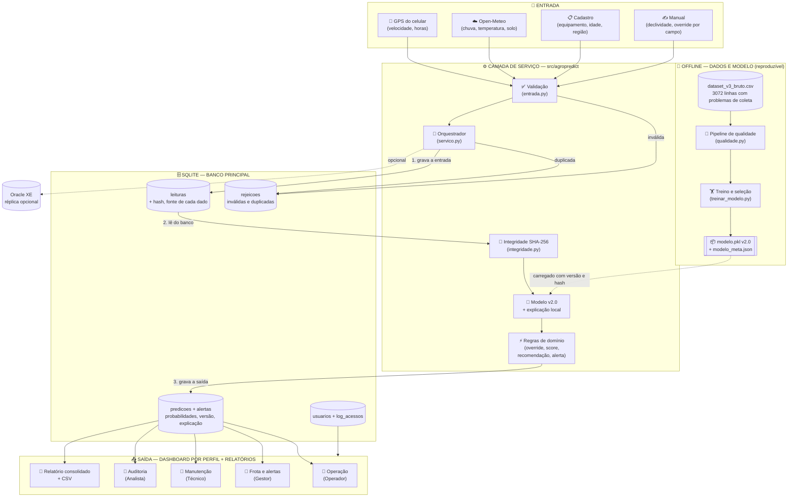
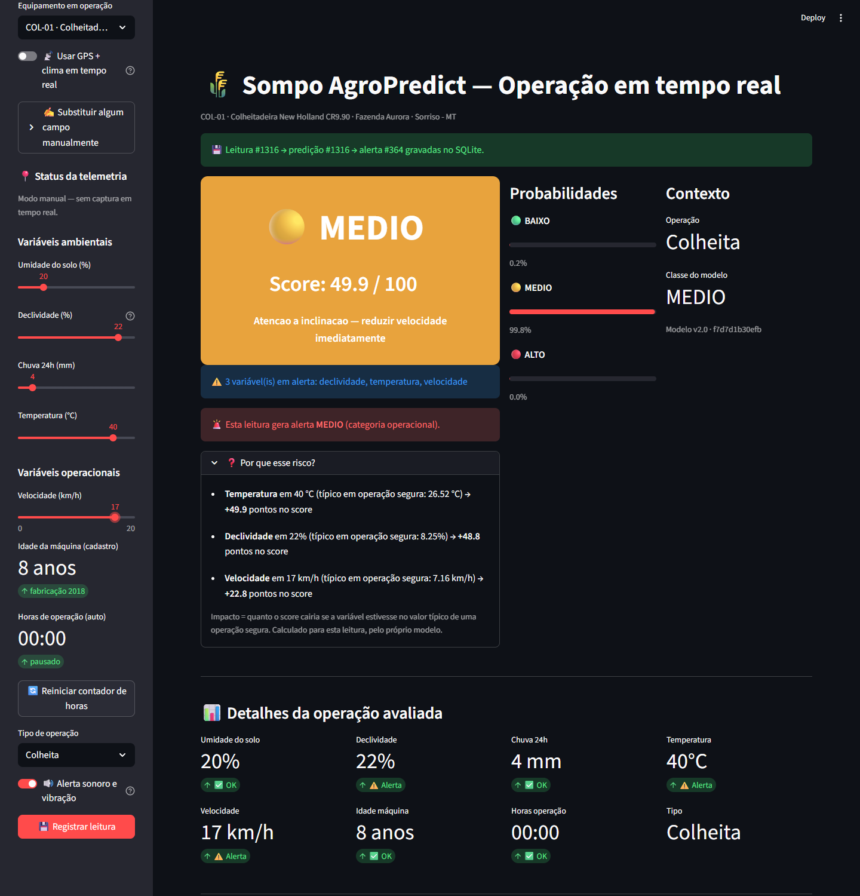
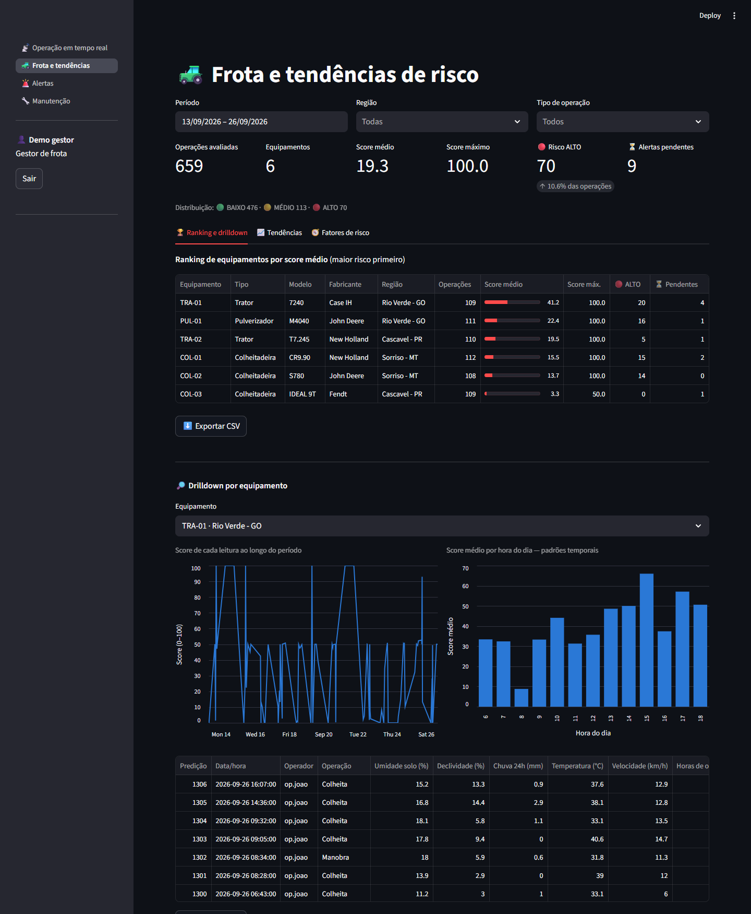
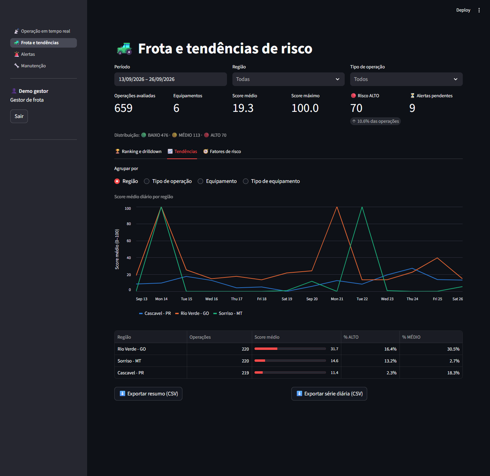
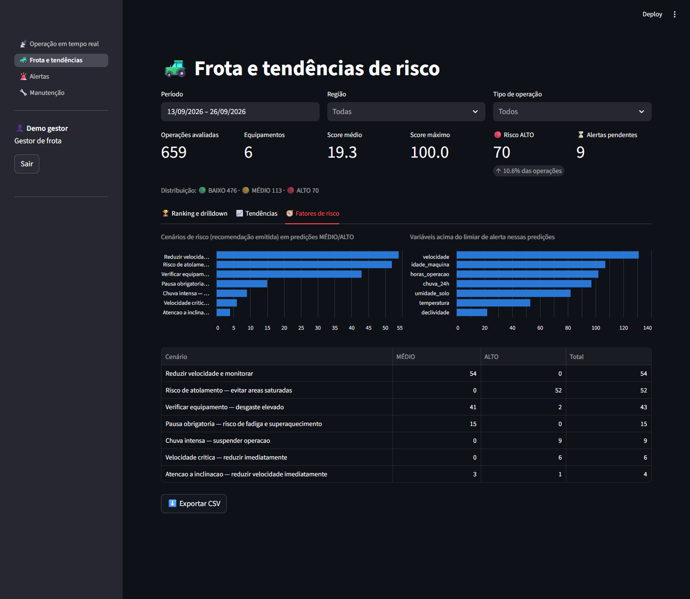
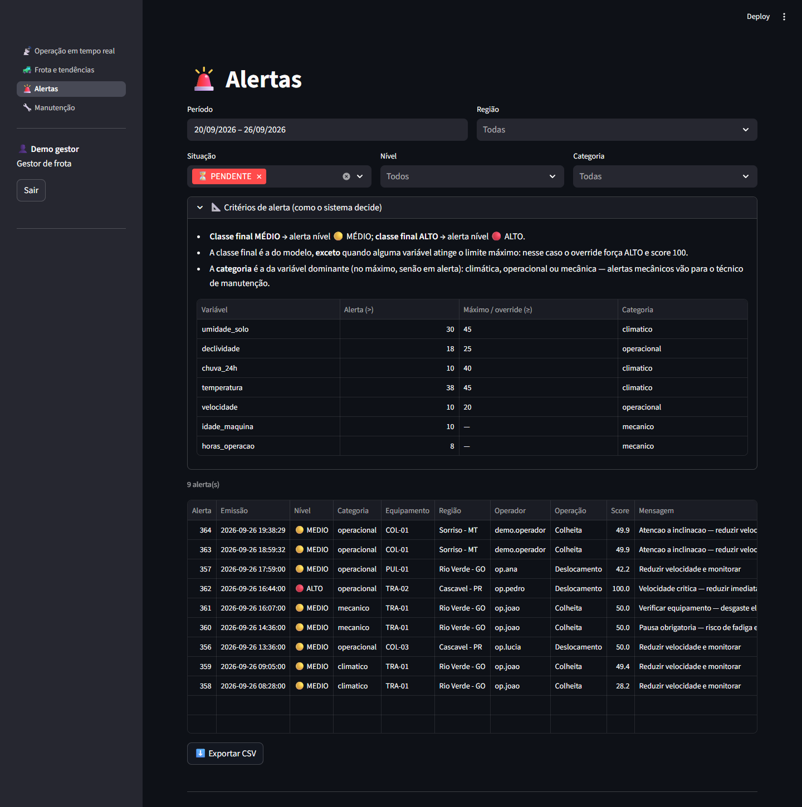
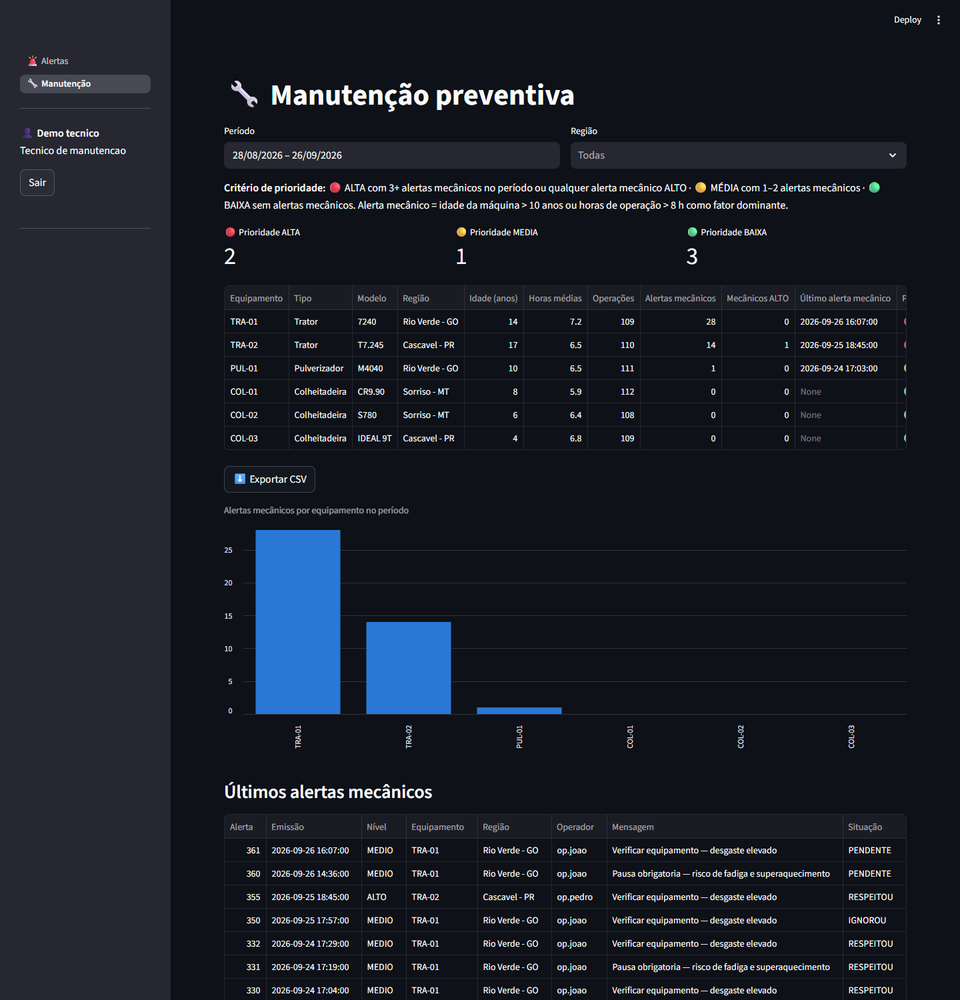
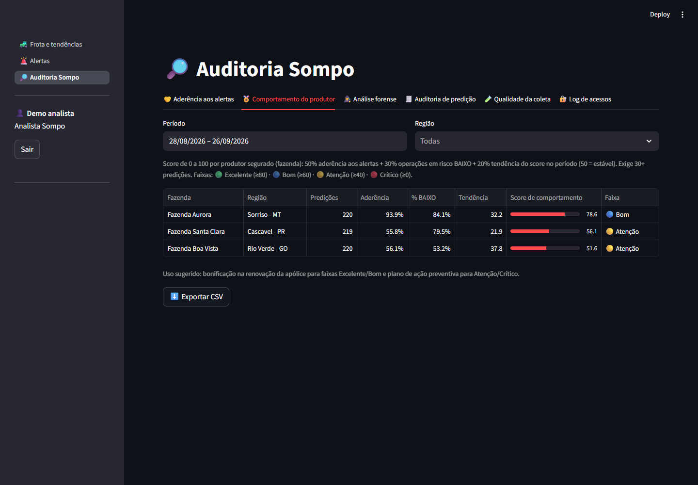
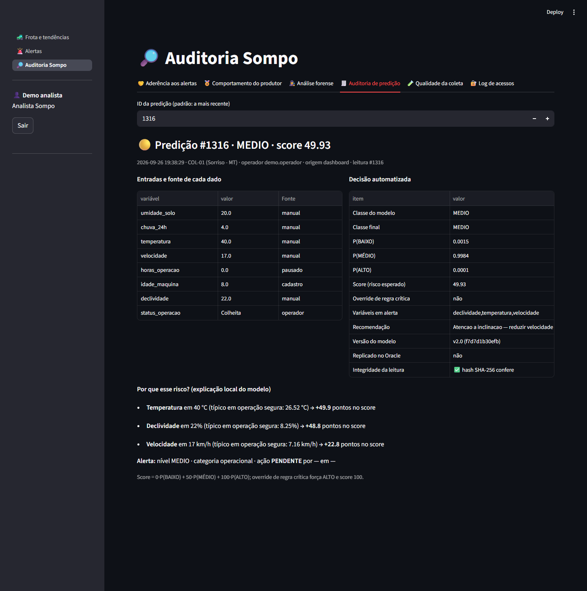
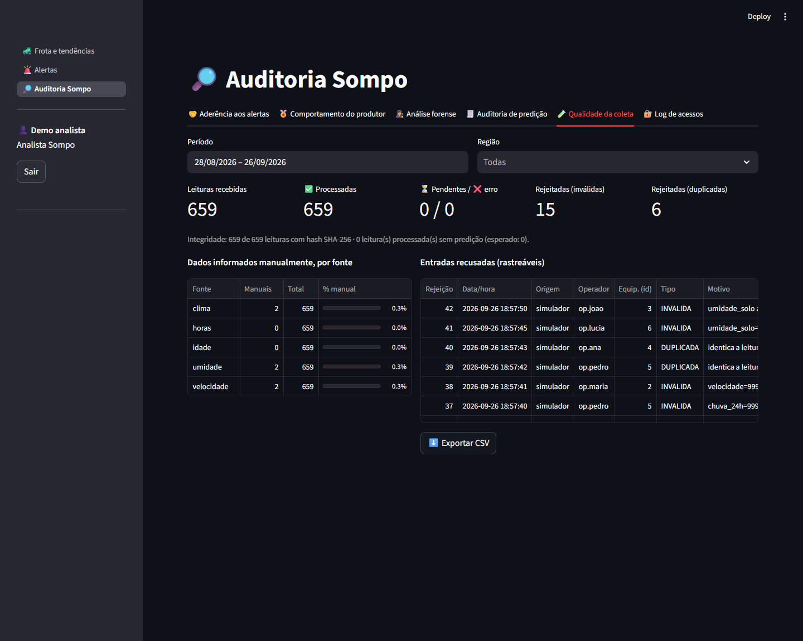

# FIAP - Faculdade de Informática e Administração Paulista

<p align="center">
<a href= "https://www.fiap.com.br/"></a>
</p>

<br>

# Sompo AgroPredict

## 👨‍🎓 Integrantes:
- Renata de Almeida Marinho — RM569342
- Giselli Mayumi Takahashi Yokoyama — RM572690
- David Ribeiro Prado de Lacerda — RM570350
- João Otavio Moraes — RM573227
- Pedro Henrique Lacerda — RM573114

### Responsabilidades

| Integrante | Responsabilidade principal |
|---|---|
| Renata de Almeida Marinho | Requisitos, documentação e validação do fluxo de negócio |
| Giselli Mayumi Takahashi Yokoyama | Engenharia de dados, SQLite e rastreabilidade |
| David Ribeiro Prado de Lacerda | Backend integrador, segurança e versionamento Git |
| João Otavio Moraes | Modelo preditivo, notebook e avaliação das métricas |
| Pedro Henrique Lacerda | Dashboard Streamlit, telemetria e testes funcionais |

## 👩‍🏫 Tutoria

- **Tutora da Turma A:** [Nicolly de Souza](https://github.com/nicollycrs) ([@nicollycrs](https://github.com/nicollycrs))

### Coordenador(a)

- André Godoi Chiovato

---

[-2C5F2D)](#)
[](#)
[-97.6%25-2C5F2D)](#-modelo-preditivo-final)
[](#-modelo-preditivo-final)
[](#-validação-e-evidências)
[](#)

---

## 📜 Descrição

> **Do reativo ao preditivo: prevenção de riscos operacionais em equipamentos agrícolas.**

O **Sompo AgroPredict** é uma plataforma de monitoramento preventivo de risco operacional para
equipamentos agrícolas. A premissa é simples: **em vez de pagar o sinistro depois, calcular o risco
antes**. O sistema coleta variáveis ambientais e operacionais, classifica o risco de cada operação em
BAIXO, MÉDIO ou ALTO com um score de 0 a 100 e devolve, para cada perfil de usuário, a informação que
ele precisa para agir antes do incidente.

Esta é a **Sprint 4 — entrega final**: o MVP consolidado, integrado e validado. Todo o fluxo
**entrada → banco → modelo → saída** roda sem depender da tela, é reproduzível com um único comando e
vem acompanhado de evidências automáticas de funcionamento.

### O que o MVP entrega a cada usuário

| Perfil | O que recebe | User Story |
|---|---|---|
| 📡 **Operador de campo** | Card de risco em tempo real, recomendação em linguagem direta, **"Por que esse risco?"** com as 3 variáveis que mais pesaram, **alerta sonoro e vibração** e resposta ao alerta (respeitei / ignorei) | US-01 |
| 🚜 **Gestor de frota** | Visão da frota: resumo do período, **ranking de equipamentos**, drilldown com padrão por hora do dia, **tendências por equipamento, região e tipo de operação**, fatores de risco e lista de alertas | US-02 |
| 🔧 **Técnico de manutenção** | Prioridade de manutenção por equipamento, com critério declarado, e alertas mecânicos | — |
| 🔎 **Analista Sompo** | Aderência dos operadores, **score de comportamento preventivo por produtor**, análise forense de sinistro, **auditoria completa de cada decisão** (probabilidades, versão do modelo, hash de integridade, explicação) e qualidade da coleta | US-03 |

Todas as telas têm exportação CSV, e o relatório consolidado da frota pode ser gerado em Markdown
por script.

---

## 🏗 Arquitetura final (ponta a ponta)



### Fluxo de uma leitura, passo a passo

1. **Coleta** — o celular do operador fornece posição e velocidade (chip GPS ou Haversine); a
   posição consulta a **Open-Meteo** (temperatura, chuva 24h, umidade do solo); a idade vem do
   **cadastro do equipamento**; a declividade entra manualmente. Qualquer campo automático pode ser
   substituído manualmente, um a um.
2. **Validação** — `Leitura.de_dict` rejeita campos ausentes, não numéricos, `NaN`, fora da faixa
   física ou tipo de operação desconhecido. A entrada recusada é gravada em `rejeicoes` com o motivo.
3. **Duplicidade** — uma retransmissão idêntica (mesmo equipamento, horário, operador e valores) é
   recusada e também registrada.
4. **Banco (entrada)** — a leitura é gravada em `leituras` com status `PENDENTE`, a origem de cada
   dado e um **hash SHA-256** do conteúdo.
5. **Modelo** — o serviço lê a leitura **do banco**, confere o hash (uma leitura alterada depois de
   gravada é recusada), calcula as probabilidades com o modelo v2.0 e a explicação local.
6. **Regras** — qualquer variável no limite crítico força ALTO (override); o score é o **risco
   esperado** `0·P(BAIXO) + 50·P(MÉDIO) + 100·P(ALTO)`; a recomendação e a categoria do alerta saem
   da causa dominante.
7. **Banco (saída)** — predição, probabilidades, versão e hash do modelo, explicação e alerta (MÉDIO
   ou ALTO) são gravados **na mesma transação** que marca a leitura como `PROCESSADA`.
8. **Saída** — o dashboard mostra o resultado conforme o perfil, e a réplica Oracle (opcional)
   recebe exatamente o mesmo resultado.

**Por que uma camada de serviço:** o dashboard, o simulador de frota, a validação da integração e a
ingestão em lote no Oracle chamam o mesmo `ServicoAvaliacao`. O fluxo funciona sem a tela aberta e a
mesma entrada gera sempre o mesmo score, a mesma classe e a mesma recomendação, qualquer que seja o
banco.

---

## 🚀 Como executar

### Pré-requisitos

| Requisito | Versão | Observação |
|---|---|---|
| Python | 3.10+ | Obrigatório (testado com 3.13) |
| Oracle XE | 21c | **Opcional** — o sistema funciona sem ele |
| Navegador móvel | — | Necessário só para GPS/clima em tempo real |

Todos os comandos abaixo devem ser executados **a partir da raiz do repositório**.

```bash
pip install -r config/requirements.txt
```

### Execução rápida — todo o fluxo com um comando

```bash
python scripts/executar_pipeline.py
```

Roda os testes automatizados, popula a frota simulada pelo fluxo completo, valida a integração com as
fontes de dados e gera o relatório consolidado da frota (em `data/`), atualizando as evidências em
[`document/evidencias/`](document/evidencias/). Com `--completo`, também regenera o dataset bruto e
retreina o modelo; com `--sem-rede`, não consulta a Open-Meteo real.

### Passo a passo

**1. (Opcional) Dados e modelo** — o dataset bruto e o modelo final já estão versionados. Para
reproduzir do zero (sementes fixas, mesmo resultado):

```bash
cd src/data
python gerar_dataset_v3.py
cd ../..
python src/modelo/treinar_modelo.py
```

O treino aplica o pipeline de qualidade, compara algoritmos, revisa variáveis, decide sobre a
calibração e grava `src/modelo/modelo.pkl`, `modelo_meta.json`, os gráficos `assets/10..13` e
[`document/relatorio_modelo.md`](document/relatorio_modelo.md).

**2. Usuários de acesso** — cada usuário tem um perfil (`operador`, `gestor`, `tecnico`, `analista`
ou `admin`). A senha é pedida no terminal e gravada apenas como hash PBKDF2:

```bash
python scripts/gerenciar_usuarios.py criar --usuario operador1 --perfil operador --nome "Operador de campo"
python scripts/gerenciar_usuarios.py criar --usuario gestor1   --perfil gestor   --nome "Gestor de frota"
python scripts/gerenciar_usuarios.py criar --usuario tecnico1  --perfil tecnico  --nome "Técnico de manutenção"
python scripts/gerenciar_usuarios.py criar --usuario analista1 --perfil analista --nome "Analista Sompo"
```

> Alternativa: definir `APP_USERNAME` e `APP_PASSWORD` (mínimo de 8 caracteres) antes de subir o
> dashboard. Esse usuário é criado automaticamente com o perfil de `APP_PERFIL` (padrão `admin`).

**3. Frota simulada** — 6 equipamentos em 3 regiões, 14 dias, cada leitura pelo mesmo fluxo do
dashboard (2% das leituras simulam falha de sensor ou retransmissão, para exercitar a rastreabilidade):

```bash
python scripts/simular_frota.py --limpar
```

**4. Dashboard**

```bash
streamlit run src/dashboard/app.py
# ou: .\scripts\run_dashboard.ps1 (Windows) / bash scripts/run_dashboard.sh (Linux/macOS)
# Acessar: http://localhost:8501
```

> Para **GPS e clima em tempo real**, abra o link no **celular do operador** — o navegador mobile pede
> permissão de localização. Sem GPS, a tela mostra uma prévia com os sliders e a leitura só é gravada
> pelo botão **💾 Registrar leitura**.

**5. Testes, validação e relatório**

```bash
python -m unittest discover -s tests -t tests
python scripts/validar_integracao.py
python scripts/gerar_relatorio.py
```

**6. (Opcional) Oracle XE** — o SQLite é o banco principal; o Oracle recebe uma réplica quando
configurado:

```bash
sqlplus "usuario"/"senha"@XE
SQL> @src/sql/schema.sql
```

Depois defina `ORACLE_USER`, `ORACLE_PASSWORD` e `ORACLE_DSN` (modelo em
[`config/.env.example`](config/.env.example)). Ingestão em lote: `python src/sql/inserir_predicoes.py --n 100`.

---

## 📁 Estrutura de pastas

```
Sompo-AgroPredict/
├── README.md
├── .github/                           # Modelo de relato de problema
├── assets/                            # Logo, gráficos do modelo e prints do dashboard
├── config/
│   ├── requirements.txt               # Dependências (arquivo único)
│   └── .env.example                   # Modelo das variáveis de ambiente
├── document/
│   ├── ai_project_document_fiap.md    # Documento formal do projeto
│   ├── user_stories.md                # 3 User Stories + rastreabilidade final
│   ├── relatorio_modelo.md            # Relatório do modelo (gerado pelo treino)
│   └── evidencias/                    # Evidências de validação do MVP (geradas por script)
├── scripts/
│   ├── executar_pipeline.py           # Fluxo completo + evidências, em um comando
│   ├── simular_frota.py               # Frota fictícia pelo fluxo real
│   ├── validar_integracao.py          # Validação das fontes de dados → evidência
│   ├── gerar_relatorio.py             # Relatório consolidado da frota (salvo em data/)
│   ├── gerenciar_usuarios.py          # Usuários e perfis de acesso
│   └── run_dashboard.ps1 / .sh        # Sobe o dashboard
├── tests/                             # 78 testes automatizados (unittest)
├── data/                              # Gerado em runtime, não versionado (SQLite + log)
└── src/
    ├── agropredict/                   # Camada de serviço (sem dependência de interface)
    │   ├── entrada.py                 # Contrato e validação da leitura
    │   ├── qualidade.py               # Pipeline de qualidade dos dados de treino
    │   ├── regras.py                  # Limiares, override, score, recomendação, alertas
    │   ├── modelo.py                  # Carrega modelo + metadados; explicação local
    │   ├── avaliacao.py               # Modelo + regras → Avaliacao (fonte única do score)
    │   ├── integridade.py             # Hash SHA-256 das leituras
    │   ├── persistencia.py            # Repositório SQLite com migrações versionadas
    │   ├── servico.py                 # Orquestrador: entrada → banco → modelo → saída
    │   ├── relatorios.py              # Consultas por equipamento, região, operação, auditoria
    │   ├── seguranca.py               # Hash de senha, bloqueio e perfis de acesso (RBAC)
    │   ├── telemetria.py              # Velocidade por GPS (chip ou Haversine)
    │   ├── clima.py                   # Integração com a Open-Meteo
    │   ├── oracle.py                  # Réplica opcional no Oracle XE
    │   ├── markdown.py                # Tabelas dos relatórios gerados
    │   ├── config.py / fabrica.py     # Configuração, logging e montagem dos serviços
    ├── dashboard/                     # Interface Streamlit (apenas entrada e saída)
    │   ├── app.py                     # Login e menu conforme o perfil
    │   ├── ui_comum.py                # Filtros, exportação CSV, alerta sonoro, explicação
    │   ├── gps.py                     # Geolocalização do navegador
    │   └── paginas/                   # operacao, frota, alertas, manutencao, auditoria
    ├── data/
    │   ├── gerar_dataset_v2.py / dataset_v2.csv          # Sprint 2 (1000 linhas)
    │   └── gerar_dataset_v3.py / dataset_v3_bruto.csv    # Sprint 4 (3072 linhas brutas)
    ├── modelo/
    │   ├── treinar_modelo.py          # Treino reproduzível do modelo final
    │   ├── modelo.pkl                 # Modelo v2.0 (Gradient Boosting)
    │   ├── modelo_meta.json           # Versão, hiperparâmetros, métricas, qualidade
    │   ├── modelo_v1.pkl              # Modelo da Sprint 2/3, mantido para comparação
    │   └── random_forest.ipynb        # Notebook exploratório da Sprint 2
    └── sql/                           # Schema Oracle, consultas e ingestão em lote
```

---

## 🗃 Engenharia de dados

### Banco principal — SQLite (`data/agropredict.db`)

Criado automaticamente, com **migrações versionadas** (`PRAGMA user_version`): um banco de uma sprint
anterior é atualizado na primeira conexão, sem perder dados.

| Tabela / view | Conteúdo |
|---|---|
| `equipamentos` | Frota com tipo, modelo, fabricante, ano, fazenda e **região** |
| `leituras` | Entrada bruta: 8 variáveis, equipamento, operador, origem, **fonte de cada dado**, posição, **hash SHA-256** e status (`PENDENTE`, `PROCESSADA`, `ERRO`) |
| `predicoes` | Classe do modelo e final, score, **probabilidades**, override e motivo, variáveis em alerta, **explicação local**, recomendação, **versão e hash do modelo** |
| `alertas` | Nível, categoria (climático, operacional, mecânico), mensagem e ação tomada, com quem respondeu e quando |
| `rejeicoes` | Toda entrada recusada — inválida ou duplicada — com motivo e dados recebidos |
| `usuarios` / `log_acessos` | Perfis, senha em hash e trilha de acessos |
| `vw_predicoes` | Visão única (entrada + decisão + equipamento + alerta) usada pelos relatórios |

Integridade garantida pelo banco: chaves estrangeiras ativas, `CHECK` em classes, status, perfis e
ações, `score_risco` entre 0 e 100, uma predição por leitura (`UNIQUE`) e gravação transacional.

### Pipeline de qualidade dos dados

Antes do treino, `src/agropredict/qualidade.py` trata o dataset bruto de forma determinística e
auditável:

| Problema encontrado no dataset bruto | Registros | Tratamento |
|---|---:|---|
| Número gravado como texto (ex.: `"12,5"`) | 60 | convertido para número |
| Valor não numérico (`"erro"`, `"N/A"`) | 10 | marcado como faltante |
| Tipo de operação com grafia inconsistente | 150 | padronizado |
| Tipo de operação desconhecido | 9 | marcado como faltante |
| Leitura fisicamente impossível (pico de sensor) | 31 | marcada como faltante |
| Rótulo com grafia inconsistente (`"Médio"`) | 62 | padronizado |
| Sem rótulo válido | 15 | linha removida |
| Duplicata exata (retransmissão) | 60 | removida, mantida a 1ª |
| Mesma entrada com rótulos diferentes | 24 | todas as ocorrências removidas |
| Mais de 2 variáveis faltantes | 15 | linha removida |

**3072 linhas brutas → 2958 aptas.** Os 338 valores faltantes restantes são imputados pela mediana
**dentro do pipeline do modelo**, ajustada só no treino — assim o conjunto de teste não vaza para o
pré-processamento. Em produção, a mesma lógica aparece na validação de entrada: nenhuma leitura
incompleta chega ao modelo.

### Réplica opcional — Oracle XE

O schema em [`src/sql/schema.sql`](src/sql/schema.sql) (equipamentos, operadores, predições, alertas,
view de métricas diárias) recebe a mesma predição gravada no SQLite. As consultas analíticas estão em
[`src/sql/consultas.sql`](src/sql/consultas.sql).

---

## 🧠 Modelo preditivo final

Relatório completo, gerado pelo próprio treino: [`document/relatorio_modelo.md`](document/relatorio_modelo.md).

### Comparação de algoritmos

Hiperparâmetros ajustados por `GridSearchCV` com validação cruzada estratificada de 5 folds, só no
conjunto de treino (2218 linhas); teste com 740 linhas nunca vistas.

| Algoritmo | F1 macro (CV) | Recall ALTO (CV) | F1 macro (teste) | Recall ALTO (teste) |
|---|---:|---:|---:|---:|
| Regressão Logística (baseline) | 87,2% | 85,9% | 89,2% | 86,5% |
| Random Forest | 92,9% | 97,0% | 96,0% | 98,1% |
| **Gradient Boosting** | **96,1%** | **97,7%** | **97,8%** | **98,7%** |

**Critério de seleção (explícito):** entre os candidatos com recall de ALTO ≥ 95% na validação
cruzada, vence o de maior F1 macro. No seguro agrícola, deixar de alertar um risco ALTO é o erro mais
caro; o F1 macro garante equilíbrio também em MÉDIO, a classe mais difícil. Venceu o
**`HistGradientBoostingClassifier`** (`learning_rate=0.05`, `max_iter=300`, `class_weight="balanced"`).


### Revisão de variáveis e calibração

- **`status_operacao` saiu do modelo:** o F1 macro na validação cruzada foi 96,05% com a variável e
  **96,21% sem ela** — ela não carrega sinal de risco nos dados. Continua sendo coletada e usada nos
  relatórios por tipo de operação.
- **Importância por permutação** (queda do F1 ao embaralhar a variável): declividade (0,20),
  umidade do solo (0,19), velocidade (0,08), temperatura (0,07), chuva 24h (0,07), horas de operação
  (0,06) e idade da máquina (0,06).
- **Calibração isotônica avaliada e não aplicada:** reduziu o log loss (0,095 → 0,083), mas piorou o
  Brier (0,0098 → 0,0137) e o F1. Com evidência mista, ficou o modelo mais simples.

### Desempenho final (teste) e evolução

| Modelo | Acurácia | F1 macro | Recall ALTO | Recall MÉDIO | ALTO previsto como BAIXO |
|---|---:|---:|---:|---:|---:|
| v1.0 — Random Forest (Sprint 2/3), no mesmo teste | 94,2% | 92,8% | 95,6% | 90,0% | 0 |
| **v2.0 — Gradient Boosting (Sprint 4)** | **98,1%** | **97,6%** | **99,1%** | **96,4%** | **0** |

Validação cruzada do modelo final: F1 macro 96,2% (±0,9%) e recall de ALTO 97,7% (±0,4%) — próximos
do teste, sem sinal de *overfitting*. Nenhuma situação ALTO é classificada como BAIXO: os erros
restantes são sempre entre classes vizinhas.

<p>


</p>

### Explicabilidade de cada decisão

Além da importância global, cada predição traz uma **explicação local**: para cada variável, o valor
lido é trocado pelo valor típico de uma operação segura (mediana das operações BAIXO no treino) e
mede-se quanto o score cai. As 3 variáveis de maior impacto são mostradas ao operador ("Por que esse
risco?") e gravadas na predição para auditoria. O override de regra crítica aparece separado, com o
motivo.

---

## ✅ Validação e evidências

| Evidência | Como é gerada | Resultado |
|---|---|---|
| [`resultado_testes.txt`](document/evidencias/resultado_testes.txt) | `python -m unittest discover -s tests -t tests` | **78 testes passando** |
| [`validacao_integracao.md`](document/evidencias/validacao_integracao.md) | `python scripts/validar_integracao.py` | **21 de 21 verificações OK** |
| [`relatorio_modelo.md`](document/relatorio_modelo.md) | `python src/modelo/treinar_modelo.py` | Métricas, comparação e justificativas do modelo |
| Prints `assets/14..22` | Dashboard com a frota simulada | Telas de cada perfil (abaixo) |

### O que a validação da integração comprova

| Grupo | Verificação |
|---|---|
| **Fonte real** | Consulta a Open-Meteo em Sorriso-MT, Rio Verde-GO e Cascavel-PR (~0,6 s cada), confere as faixas físicas e envia o clima real pelo fluxo completo até a predição |
| **Falhas da fonte** | Timeout, falta de conexão, HTTP 500, JSON inválido e resposta incompleta viram `ok=False`, sem exceção, e o sistema cai para entrada manual |
| **GPS** | Trajeto simulado a 12 km/h calculado com erro de 0,00 km/h; salto de sinal descartado; velocidade do chip convertida corretamente |
| **Sem perda de dados** | 514 leituras enviadas (com ~5% de problemas e ~3% de retransmissões injetados) = 481 gravadas + 19 inválidas + 14 duplicadas, todas as rejeições registradas com motivo |
| **Sem corrupção** | Valores gravados idênticos aos enviados; 100% dos hashes conferem; score gravado = risco esperado recalculado; reavaliação reproduz o mesmo score |
| **Alertas** | Todo MÉDIO/ALTO tem alerta; nenhum BAIXO tem |
| **Corrupção no banco** | Uma leitura alterada depois de gravada é recusada e marcada como `ERRO` |
| **SQLite × Oracle** | Mesmo score, classe e versão do modelo nas duas persistências |

### Cobertura dos testes automatizados

`tests/` cobre regras e score, validação de entrada, pipeline de qualidade, modelo (metadados,
explicação, modelo legado, arquivo corrompido), migração de banco antigo, fluxo de ponta a ponta
(integridade, duplicatas, rejeições, reprocessamento), fontes de dados (Open-Meteo com respostas
simuladas e cálculo de velocidade), segurança (hash, bloqueio, perfis), relatórios e consistência com
o Oracle.

---

## 🔒 Segurança e rastreabilidade

| Controle | Onde | Como |
|---|---|---|
| **Autenticação** | `seguranca.py` | Senhas só como hash **PBKDF2-SHA256 com salt** (200 mil iterações), mínimo de 8 caracteres, comparação em tempo constante; nenhuma credencial no código |
| **Bloqueio por tentativas** | `seguranca.py` | 5 logins errados em 15 minutos bloqueiam o usuário, mesmo com a senha correta |
| **Controle de acesso por perfil (RBAC)** | `PERMISSOES` + `exigir()` em cada página | Cada perfil vê só as suas páginas; cada página confere a permissão de novo; o operador só vê os próprios alertas |
| **Log de acessos** | `log_acessos` | Login, tentativa negada, bloqueio, acesso negado a uma área e logout, com perfil — sem senha |
| **Validação de entrada** | `entrada.py` | Nada ausente, não numérico ou fisicamente impossível chega ao banco ou ao modelo |
| **Rastreabilidade das entradas recusadas** | `rejeicoes` | Toda entrada inválida ou duplicada fica registrada com origem, operador, motivo e dados recebidos |
| **Integridade das leituras** | `integridade.py` | Hash SHA-256 gravado com a leitura e conferido antes do modelo; alteração posterior é detectada |
| **Integridade do banco** | `persistencia.py` | Chaves estrangeiras, `CHECK`, `UNIQUE` e gravação transacional (tudo ou nada) |
| **Rastreabilidade da decisão** | `predicoes` | Probabilidades, classe do modelo e final, override, explicação local, `versao_modelo` e **hash do arquivo do modelo** — base para revisão de decisão automatizada (LGPD, art. 20) |
| **Trilha dos alertas** | `alertas` | Quem respondeu, quando e o que fez — evidência para análise forense de sinistro |
| **Log da aplicação** | `data/agropredict.log` | Cada leitura, predição (classe, score, probabilidades, versão), rejeição e resposta a alerta |
| **Credenciais fora do código** | `config.py`, `.env.example` | Oracle e usuário inicial via variáveis de ambiente; `config/.env` e `data/` fora do Git |
| **Resiliência** | `oracle.py`, `clima.py`, `servico.py` | Falha no Oracle ou na API de clima não derruba o fluxo; leitura que falha no processamento fica marcada como `ERRO` |

**Pendências assumidas:** usuário Oracle de aplicação com privilégio mínimo (depende da administração
do Oracle); CPF em texto claro no schema Oracle opcional (só dados fictícios — o SQLite não guarda
CPF); criptografia do arquivo SQLite em repouso (em produção, disco criptografado no servidor).

---

## 📊 Relatórios, alertas e visualização

### Páginas por perfil

| Página | Operador | Gestor | Técnico | Analista | Admin |
|---|:---:|:---:|:---:|:---:|:---:|
| 📡 Operação em tempo real | ✅ | ✅ | | | ✅ |
| 🚜 Frota e tendências | | ✅ | | ✅ | ✅ |
| 🚨 Alertas | ✅ (só os seus) | ✅ | ✅ (mecânicos por padrão) | ✅ | ✅ |
| 🔧 Manutenção | | ✅ | ✅ | | ✅ |
| 🔎 Auditoria Sompo | | | | ✅ | ✅ |

### Critérios de alerta (explícitos na tela)

| Variável | Alerta (>) | Máximo / override (≥) | Categoria |
|---|---:|---:|---|
| Umidade do solo (%) | 30 | 45 | climático |
| Declividade (%) | 18 | 25 | operacional |
| Chuva 24h (mm) | 10 | 40 | climático |
| Temperatura (°C) | 38 | 45 | climático |
| Velocidade (km/h) | 10 | 20 | operacional |
| Idade da máquina (anos) | 10 | — | mecânico |
| Horas de operação | 8 | — | mecânico |

- Classe final **MÉDIO** → alerta MÉDIO (um sinal sonoro curto); classe final **ALTO** → alerta ALTO
  (sinal repetido e vibração a cada ciclo).
- A **categoria** é a da variável dominante e direciona o alerta: mecânico → técnico de manutenção.
- **Prioridade de manutenção:** ALTA com 3+ alertas mecânicos no período ou qualquer alerta mecânico
  ALTO; MÉDIA com 1–2; BAIXA sem alertas mecânicos.
- **Score de comportamento do produtor (CA-03.2):** 50% aderência aos alertas + 30% operações em BAIXO
  + 20% tendência do score no período; faixas Excelente (≥80), Bom (≥60), Atenção (≥40) e Crítico.

### Prints do MVP

| | |
|---|---|
|  **Operador:** leitura MÉDIO gravada, "Por que esse risco?" e alerta |  **Gestor:** resumo, ranking e drilldown por hora |
|  **Gestor:** tendência diária por região |  **Gestor:** fatores de risco predominantes |
|  **Alertas** com critérios explícitos e resposta |  **Técnico:** prioridade de manutenção |
|  **Analista:** comportamento por produtor |  **Analista:** auditoria completa de uma decisão |
|  **Analista:** qualidade e rastreabilidade da coleta | |

---

## 📋 User Stories

Documento completo, com a rastreabilidade de cada critério de aceite, em
[`document/user_stories.md`](document/user_stories.md).

| ID | Persona | Resumo | Situação final |
|---|---|---|---|
| **US-01** | Operador de Campo | Alerta preventivo em tempo real com sinalização visual + sonora | 4/4 critérios implementados |
| **US-02** | Gestor de Frota | Visão da frota com ranking de equipamentos, drilldown e fatores de risco | 4/4 critérios implementados |
| **US-03** | Analista Sompo | Aderência, comportamento do produtor, análise forense e auditoria | 4/4 critérios implementados |

---

## 🧭 Decisões técnicas ao longo das 4 sprints

| Sprint | Decisão | Justificativa |
|---|---|---|
| 1 | Variáveis captáveis **fora da máquina** (celular, API de clima, cadastro) | Viabiliza frotas legadas sem telemetria embarcada: "abrir um link no celular" em vez de instalar hardware |
| 1 | Três personas e risco em três níveis (BAIXO/MÉDIO/ALTO) com score e recomendação | Cada perfil decide em uma escala de tempo diferente; três níveis por cor são acionáveis no campo |
| 1 | Random Forest proposto, com Gradient Boosting "mantido como alternativa para a v2" | Interações não lineares e interpretabilidade; o Gradient Boosting foi deixado para quando houvesse mais dados — e venceu a comparação da Sprint 4 |
| 2 | Dataset simulado estratificado por cenário, 8 variáveis, e User Stories formalizadas | Feedback da Sprint 1 (ampliar as variáveis; User Stories só implícitas nas personas); sem histórico real de sinistros, a estratificação garante exemplos das três classes |
| 2 | Random Forest com baseline de Regressão Logística | Captura interações não lineares ("umidade alta **e** chuva") e oferece importância das variáveis |
| 2 | Regras de domínio com **override** para ALTO | Em situação inequivocamente perigosa, a segurança não depende de um modelo treinado em dados simulados |
| 3 | GPS do celular + Open-Meteo com substituição manual campo a campo | Dados reais sem hardware dedicado, sem parar a operação quando um sensor falha |
| 3 | **SQLite como banco principal**, Oracle como réplica opcional | O MVP roda em qualquer máquina, sem serviço externo, mantendo o caminho para um banco central |
| 3.1 | Camada de serviço independente da interface | Correção do feedback: o fluxo não pode depender da tela |
| 3.1 | Score = **risco esperado** em uma única função | Correção do feedback: SQLite e Oracle gravavam scores diferentes. A Sprint 1 definia o score como a probabilidade da classe prevista, mas essa é a confiança do modelo, não o risco |
| 3.1 | Perfis de acesso e visão de frota | Correção do feedback: três personas com um único perfil e sem visão por equipamento/região |
| 4 | Pipeline de qualidade sobre um dataset **bruto** e imputação dentro do pipeline | Dados reais chegam sujos; imputar só com o treino evita vazamento para o teste |
| 4 | Seleção por **recall de ALTO**, depois F1 macro | O falso negativo de ALTO é o erro mais caro para o operador e para a seguradora |
| 4 | Gradient Boosting, sem `status_operacao`, sem calibração | Decididos por evidência: melhor F1 com recall protegido; variável sem sinal; calibração com resultado misto |
| 4 | Hash SHA-256 por leitura e tabela de rejeições | Comprovar que o dado que alimenta o modelo é íntegro e que nenhuma entrada some sem registro |
| 4 | Explicação local por predição | O operador entende o alerta e a seguradora consegue justificar cada decisão automatizada |
| 4 | Migrações versionadas do banco e pipeline de um comando | Evoluir o schema sem perder dados e reproduzir todo o MVP com as mesmas sementes |

## 📈 Evolução do projeto

| Aspecto | Sprint 1 | Sprint 2 | Sprint 3 | Sprint 4 |
|---|---|---|---|---|
| Foco | Problema e proposta | Modelo preditivo | Integração | Consolidação e validação |
| Dados | 5 variáveis definidas, tabela ilustrativa | 1000 linhas, 8 variáveis | + GPS e clima reais | 3072 linhas brutas tratadas por pipeline de qualidade |
| Modelo | Proposto, não implementado | Random Forest (notebook) | Mesmo modelo | Gradient Boosting v2.0, treino reproduzível, explicação local |
| Banco | Conceitual | Schema Oracle (4 tabelas, view, constraints) | SQLite com histórico | Leituras antes do modelo, integridade, rejeições, migrações |
| Interface | Mockups | Dashboard único | Dashboard com telemetria | 5 páginas por perfil, alertas sonoros, exportação |
| Segurança | Diretrizes (autenticação, criptografia, LGPD) | Constraints, chaves estrangeiras e versão do modelo por predição | Login único e log de acesso | RBAC, senha em hash, bloqueio, integridade, auditoria completa |
| Validação | — (proposta documentada, sem código) | Métricas no notebook | Execução manual | 78 testes + validação de integração + relatório gerados por script |

---

## ⚠️ Limitações conhecidas

- **Dados simulados.** O modelo aprende regras de domínio sobre dados simulados; avaliá-lo em campo
  exige histórico de sinistros rotulados. As leituras gravadas em `leituras` são o embrião desse
  dataset real.
- **Variáveis ainda não automáticas:** declividade (depende de mapa GIS por talhão) e umidade do solo
  (aproximação da Open-Meteo para a camada de 0–1 cm, não um sensor).
- **Telemetria no navegador:** geolocalização exige HTTPS em produção; `coords.speed` só vem em
  celulares com GPS ativo e em movimento; o ciclo de 10 s não capta eventos mais rápidos; o contador
  de horas depende da aba aberta.
- **Alerta sonoro e vibração** dependem do navegador: o som pode exigir uma interação prévia com a
  página e a vibração só existe em celulares Android. O alerta visual vale sempre.
- **Banco local:** o SQLite fica na máquina de quem roda o dashboard; a sincronização central seria o
  papel do Oracle.
- **Frota e operadores fictícios**, identificados como `origem = 'simulador'` no banco.
- **Visão da Sprint 1 fora do MVP:** modo offline no celular (arquitetura *Edge + Cloud*), mapa de calor
  por talhão e inclinação lateral pelo giroscópio do celular continuam como evolução de produto.

---

## 🎬 Vídeo de apresentação

🎬 **Link do vídeo (Sprint 4):** [https://youtu.be/ORZft21xtqs](https://youtu.be/ORZft21xtqs)

---

## 🗃 Histórico de lançamentos

* 0.4.0 - Sprint 4 — **MVP consolidado e validado**
    * Pipeline de qualidade e dataset bruto v3 (3072 linhas); treino reproduzível com comparação de algoritmos
    * Modelo v2.0 (Gradient Boosting): F1 macro 97,6% e recall de ALTO 99,1% no teste; explicação local por predição
    * Hash de integridade por leitura, rejeição rastreável de entradas inválidas e duplicadas, migrações de banco
    * Alerta sonoro e vibração, score de comportamento do produtor, qualidade da coleta e exportação CSV
    * Validação da integração, relatório consolidado e pipeline de ponta a ponta com um comando; 78 testes
* 0.3.1 - 26/09/2026 — **Correções a partir do feedback da Sprint 3**
    * Camada de serviço `src/agropredict`; leitura gravada antes do modelo; score único para SQLite e Oracle
    * Probabilidades e versão do modelo no SQLite; perfis de acesso; páginas de frota, alertas, manutenção e auditoria
* 0.3.0 - 24/08/2026 — **Sprint 3: integração end-to-end**
    * Telemetria real: GPS do celular e API Open-Meteo; persistência automática no SQLite
    * Contador automático de horas de operação e substituição manual por campo
* 0.2.0 - Sprint 2 — **Modelo preditivo**
    * Random Forest treinado e validado; dataset com 8 variáveis e 1000 linhas; schema Oracle; dashboard; User Stories
* 0.1.0 - Sprint 1 — **Estrutura inicial e proposta documentada**
    * Proposta documentada, sem código: problema, personas, variáveis, modelo proposto, arquitetura, diretrizes de segurança, mockups e vídeo

---

## 📋 Licença

<p xmlns:cc="http://creativecommons.org/ns#" xmlns:dct="http://purl.org/dc/terms/"><a property="dct:title" rel="cc:attributionURL" href="https://github.com/agodoi/template">MODELO GIT FIAP</a> por <a rel="cc:attributionURL dct:creator" property="cc:attributionName" href="https://fiap.com.br">Fiap</a> está licenciado sobre <a href="http://creativecommons.org/licenses/by/4.0/?ref=chooser-v1" target="_blank" rel="license noopener noreferrer" style="display:inline-block;">Attribution 4.0 International</a>.</p>
