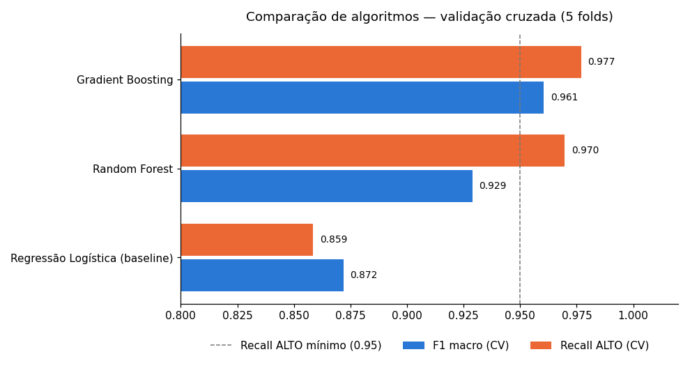
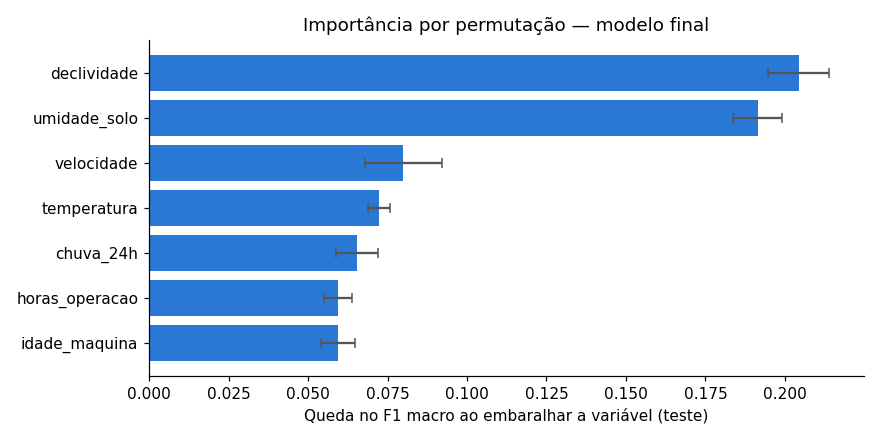
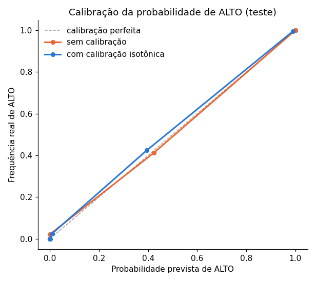
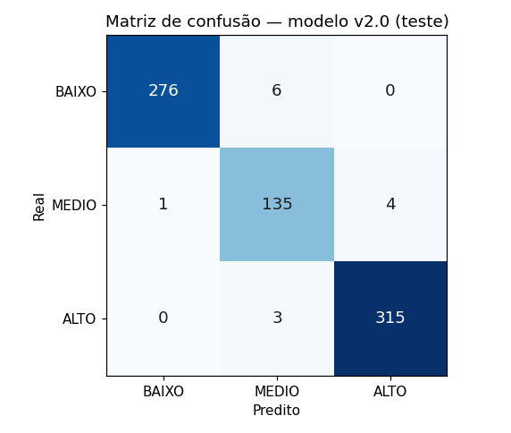

# Relatório do modelo v2.0

> Gerado automaticamente por `src/modelo/treinar_modelo.py` em 2026-09-26T18:54:50 (scikit-learn 1.8.0). Não edite à mão: rode o script de novo.

## 1. Dados e qualidade

Dataset bruto `src/data/dataset_v3_bruto.csv` (simulado, sha256 `e8d503903b0503a0`), com problemas de coleta injetados de propósito para exercitar o pipeline de qualidade (`src/agropredict/qualidade.py`):

Linhas recebidas: **3072** · linhas aptas para o modelo: **2958**

| Etapa | Registros afetados | Tratamento |
|---|---:|---|
| Número gravado como texto (ex.: "12,5") | 60 | convertido para número |
| Valor não numérico | 10 | marcado como faltante |
| Tipo de operação com grafia inconsistente | 150 | padronizado |
| Tipo de operação desconhecido | 9 | marcado como faltante |
| Leitura fisicamente impossível (sensor) | 31 | marcada como faltante |
| Rótulo com grafia inconsistente | 62 | padronizado |
| Sem rótulo válido | 15 | linha removida |
| Duplicata exata (retransmissão) | 60 | removida, mantida a 1ª ocorrência |
| Mesma entrada com rótulos diferentes | 24 | todas as ocorrências removidas |
| Mais de 2 variáveis faltantes | 15 | linha removida |

Valores faltantes restantes, imputados no pipeline pela mediana do treino: **338**

Distribuição após a limpeza: {'ALTO': 1272, 'BAIXO': 1125, 'MEDIO': 561}. Split estratificado: 2218 treino / 740 teste.

## 2. Comparação de algoritmos

Cada candidato teve os hiperparâmetros ajustados por `GridSearchCV` com validação cruzada estratificada de 5 folds, só no conjunto de treino.

| Algoritmo | Melhores hiperparâmetros | F1 macro (CV) | Recall ALTO (CV) | F1 macro (teste) | Recall ALTO (teste) |
|---|---|---:|---:|---:|---:|
| Regressão Logística (baseline) | `{'C': 10.0}` | 0.8719 | 0.8585 | 0.8915 | 0.8648 |
| Random Forest | `{'max_depth': 16, 'min_samples_leaf': 1}` | 0.9289 | 0.9696 | 0.9603 | 0.9811 |
| **Gradient Boosting** | `{'learning_rate': 0.05, 'max_depth': None, 'max_iter': 300}` | 0.9605 | 0.9769 | 0.9776 | 0.9874 |

**Critério de seleção:** maior F1 macro na validacao cruzada entre os candidatos com recall de ALTO >= 0.95. No seguro agrícola, deixar de alertar um risco ALTO (falso negativo) é o erro mais caro; entre os modelos que protegem essa classe, o F1 macro garante equilíbrio também em MÉDIO, a classe mais difícil por ficar entre as outras duas.

**Escolhido:** Gradient Boosting — `{'learning_rate': 0.05, 'max_depth': None, 'max_iter': 300}`.

## 3. Revisão de variáveis

- `status_operacao`: F1 macro na validação cruzada **com** a variável = 0.9605, **sem** = 0.9621. Decisão: **removida** (regra: sai se a perda for menor que 0.005). O tipo de operação continua sendo coletado e usado nos relatórios por tipo de operação.
- Variáveis usadas pelo modelo final: `umidade_solo`, `declividade`, `chuva_24h`, `temperatura`, `velocidade`, `idade_maquina`, `horas_operacao`.

Importância por permutação no conjunto de teste (queda do F1 macro ao embaralhar cada variável):

| Variável | Importância | Desvio |
|---|---:|---:|
| `declividade` | 0.2043 | 0.0097 |
| `umidade_solo` | 0.1914 | 0.0076 |
| `velocidade` | 0.0800 | 0.0120 |
| `temperatura` | 0.0723 | 0.0036 |
| `chuva_24h` | 0.0654 | 0.0065 |
| `horas_operacao` | 0.0595 | 0.0044 |
| `idade_maquina` | 0.0594 | 0.0055 |

## 4. Calibração das probabilidades

O score de risco é o risco esperado, `0·P(BAIXO) + 50·P(MÉDIO) + 100·P(ALTO)`; por isso a qualidade das **probabilidades** importa tanto quanto a classe prevista.

| | Log loss | Brier médio | F1 macro |
|---|---:|---:|---:|
| Sem calibração | 0.0948 | 0.0098 | 0.9757 |
| Calibração isotônica | 0.0830 | 0.0137 | 0.9722 |

Decisão: **nenhuma**. Regra: a calibração só é aplicada se reduzir **o log loss e o Brier** sem perder mais de 1 ponto de recall em ALTO; com evidência mista, fica o modelo mais simples.

## 5. Desempenho final no conjunto de teste

| Métrica | Valor |
|---|---:|
| Acurácia | 98.1% |
| F1 macro | 97.6% |
| Recall BAIXO | 97.9% |
| Recall MEDIO | 96.4% |
| Recall ALTO | 99.1% |
| Precisão BAIXO | 99.6% |
| Precisão MEDIO | 93.8% |
| Precisão ALTO | 98.8% |
| Log loss | 0.0948 |
| ALTO previsto como BAIXO | 0 |

### Comparação com o modelo anterior (v1.0) no mesmo teste

| Modelo | Acurácia | F1 macro | Recall ALTO | Recall MÉDIO | Log loss |
|---|---:|---:|---:|---:|---:|
| v1.0 (Sprint 2/3) | 94.2% | 92.8% | 95.6% | 90.0% | 0.1949 |
| **v2.0 (Sprint 4)** | **98.1%** | **97.6%** | **99.1%** | **96.4%** | **0.0948** |

> O modelo anterior não trata faltantes; para compará-lo, os faltantes do teste foram preenchidos com a mediana do treino.

## 6. Limitações

- As métricas são sobre dados **simulados**: os rótulos seguem regras de domínio, então o modelo aprende essas regras. Avaliar em dados reais exige histórico de sinistros rotulados.
- O modelo final é reajustado com todas as linhas limpas depois da avaliação; as métricas acima vêm do modelo treinado só com o conjunto de treino.
